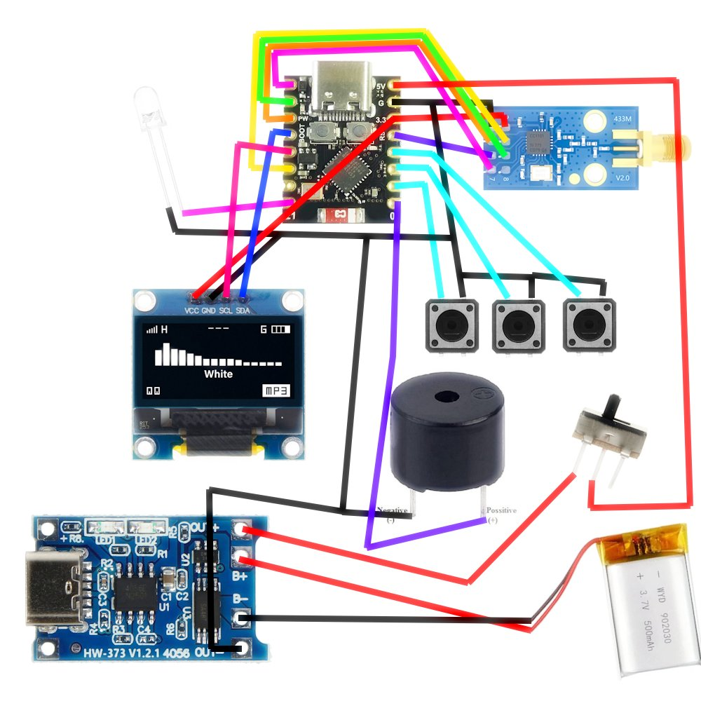

<p align="center">
  
</p>

<h1 align="center">Bruce — ESP32-C3</h1>

<p align="center">
  Bruce firmware (1.17 style) for ESP32-C3 with SSD1306 128×64 OLED.<br>
  Pure Bruce UI, boot animation and menu.
</p>

<p align="center">
  
  
</p>

## Features

- **WiFi** — Scan, Beacon Spam
- **BLE** — Scan, Spam
- **RF (CC1101)** — Scan/Copy, Send, Jammer, Identifier, Tesla Charge Port, Spectrum
- **IR** — TV-B-Gone (EU/NA), Spammer, Universal Remote
- **Others** — Buzzer
- **Config** — Display & UI, System Config, About

## Hardware

| Component | Detail |
|---|---|
| MCU | ESP32-C3 SuperMini |
| Display | SSD1306 128×64 OLED (I2C, 0x3C) |
| RF | CC1101 433 MHz |
| Others | IR TX LED, buzzer, 3 buttons |

## Wiring



## Controls

- **Left / Right** — Navigate
- **Center** — Select
- **Center (long press)** — Back

## Flashing

Flash the single merged file `bruce-esp32c3-single.bin` at offset **0x0**:

**Flashing offset: `0x0`** — single file only, no separate bootloader/partitions files needed.

```bash
nrflash write --chip esp32c3 '0x0000:bruce-esp32c3-single.bin' --verify
```

## Extra Firmware (Watch Style)

Extra watch-style firmwares for the same device are in [`extra/`](extra/) — flash at offset **0x0** like the main firmware:

| File | Description |
|---|---|
| [`pocket-flipper.bin`](extra/pocket-flipper.bin) | Watch style with Flipper Zero boot animation |
| [`pocket-puter-nwatch-same-ui-single.bin`](extra/pocket-puter-nwatch-same-ui-single.bin) | NWatch same-to-same UI (11 watch faces) |
| [`pocket-puter-final-single.bin`](extra/pocket-puter-final-single.bin) | Watch style final (Settings INFO: HACKTHON) |

## Credits

Based on the official [Bruce](https://github.com/pr3y/Bruce) firmware by pr3y.

Ported for ESP32-C3 + SSD1306 OLED by **HACKTHON (IMRAN)**.
