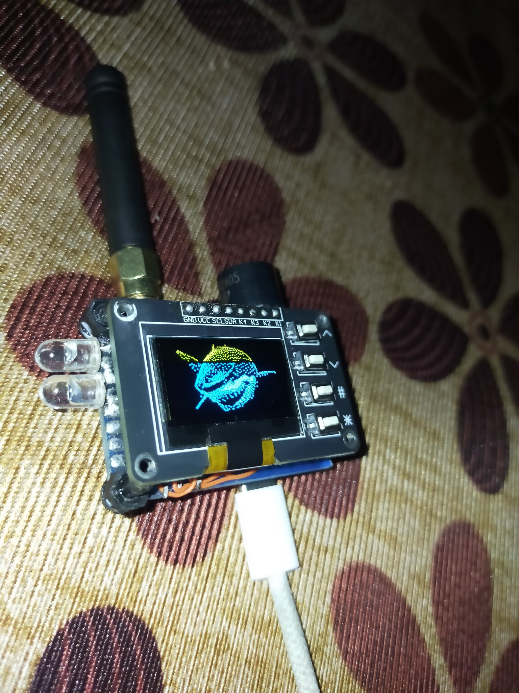
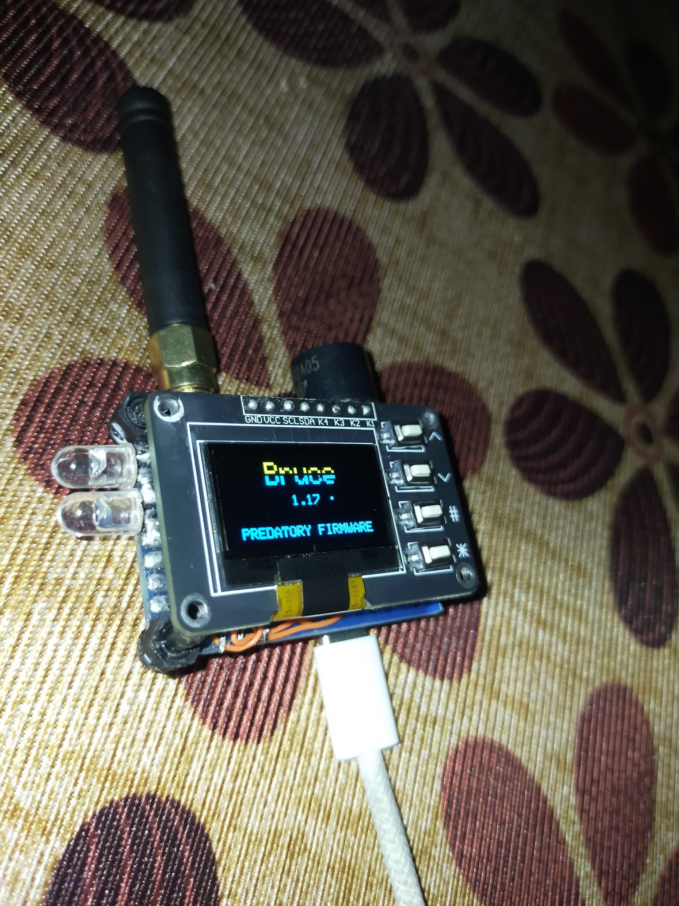

# Bruce — ESP32-C3

Bruce firmware (1.17 style) for ESP32-C3 with SSD1306 128x64 OLED.
Pure Bruce UI, boot animation and menu — no other branding.




## Features

- **WiFi** — Scan, Beacon Spam
- **BLE** — BLE Scan, BLE Spam
- **RF (CC1101)** — Scan/Copy, Send, Jammer, Identifier, Tesla Charge Port, Spectrum
- **IR** — TV-B-Gone (EU/NA), Spammer, Universal Remote (TVs/Projectors)
- **Others** — Buzzer
- **Config** — Display & UI, System Config, About

## Hardware

- ESP32-C3 SuperMini
- SSD1306 I2C 128x64 OLED (0x3C)
- CC1101 433MHz RF module
- IR TX LED, Buzzer, 3 Buttons (Left / Center / Right)

## Controls

- Left / Right — Navigate
- Center — Select
- Center Long Press — Back

## Flashing

Flash the single merged file `bruce-esp32c3-single.bin` at offset **0x0**:

```
nrflash write --chip esp32c3 '0x0000:bruce-esp32c3-single.bin' --verify
```

## Headless Mode

- SSID: `Bruce`
- Password: `bruce123`
- Web: `bruce.local`

## Credits

Based on the official **Bruce** firmware by pr3y:
https://github.com/pr3y/Bruce

Ported for ESP32-C3 + SSD1306 OLED by **HACKTHON (IMRAN)**.
