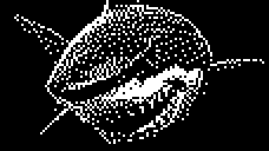
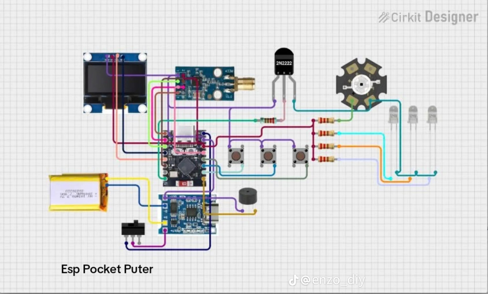
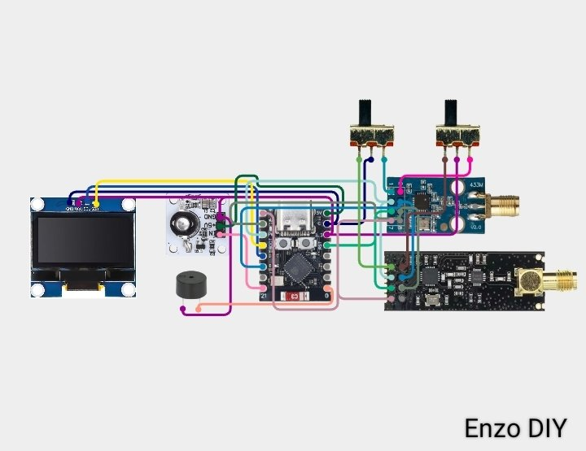

$$\color{red}\text{This program is still in beta stage.}$$
$$\color{red}\text{Chương trình này vẫn đang ở giai đoạn beta.}$$
$$\color{red}\text{Due to some problems in the firmware, there is an auto restart problem.}$$
$$\color{red}\text{Do firmware có một số vấn đề nên có hiện tượng tự khởi động lại.}$$
<p align="center"><small>By using this firmware, you can get the feel of Bruce, and the biggest update is coming in the future.</small></p>
<p align="center"><small>Sử dụng firmware này, bạn có thể cảm nhận được Bruce, và bản cập nhật lớn nhất sẽ đến trong tương lai.</small></p>
<p align="center">Code by : Enzo DIY and Hackthon</p>

<p align="center">
  
</p>

<p align="center">
  <a href="https://github.com/umtan234/Bruce-ESP32-C3/releases/latest"></a>
</p>

<h1 align="center">Bruce — ESP32-C3</h1>

<p align="center">
  Bruce firmware (1.17 style) for ESP32-C3 with SSD1306 128×64 OLED.<br>
  Pure Bruce UI, boot animation and menu.
</p>

<p align="center">
  
  
</p>

## 🎬 Video

**[▶ Watch the video on Facebook — Esp32 c3 mini Bruce + 0.96 oled](https://m.facebook.com/groups/1405728658255539/permalink/1589455223216214/?ref=share&mibextid=NOb6eG)**

Demo video of Bruce running on ESP32-C3 with a 0.96" OLED, posted by Imran Hasan in the Embedded & IoT Community / BD-VN-PH Facebook group.

## Features

- **WiFi** — Scan, Beacon Spam
- **BLE** — Scan, Spam
- **RF (CC1101)** — Scan/Copy, Send, Jammer, Identifier, Tesla Charge Port, Spectrum
- **IR** — TV-B-Gone (EU/NA), Spammer, Universal Remote
- **Others** — Buzzer
- **Config** — Display & UI, System Config, About

## Boot Animations

**Bruce boot animation:**


**Flipper Zero animations:**


## Hardware

| Component | Detail |
|---|---|
| MCU | ESP32-C3 SuperMini |
| Display | SSD1306 128×64 OLED (I2C, 0x3C) |
| RF | CC1101 433 MHz |
| Others | IR TX LED, buzzer, 3 buttons |

## Wiring



**Next update:** In the next update, NRF24 will also be included.
Trong bản cập nhật tiếp theo, NRF24 cũng sẽ có.



## Controls

- **Left / Right** — Navigate
- **Center** — Select
- **Center (long press)** — Back

## Flashing

Flash the single merged file `BrucOled-beta.bin` at offset **0x0**:

**Flashing offset: `0x0`** — single file only, no separate bootloader/partitions files needed.

```bash
nrflash write --chip esp32c3 '0x0000:BrucOled-beta.bin' --verify
```

For web flashing, use the [Dănutz - DIY](https://danutz-diy.com/) tool.

## Extra Firmware (Watch Style)

Extra watch-style firmware for the same device — flash at offset **0x0** like the main file:

| File | Description |
|---|---|
| [`BrucOled-beta.bin`](BrucOled-beta.bin) | Bruce firmware (1.17 style) for ESP32-C3 with SSD1306 OLED |

---

Based on official [Bruce](https://github.com/pr3y/Bruce) by pr3y.
Ported for ESP32-C3 SuperMini + SSD1306 OLED by **HACKTHON (IMRAN)**.

Credit: [DevEclipse1](https://github.com/DevEclipse1)
